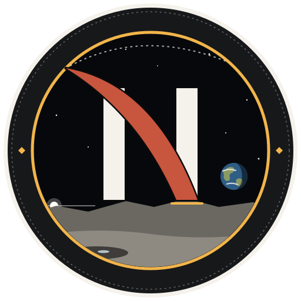

<p align="center">
  <a href="https://nexus.xinocore.com"></a>
</p>

<p align="center">
  
</p>

<h1 align="center">NEXUS: Last Horizon</h1>

<p align="center">
  <em>Build a base on the Moon's south pole. Real space weather decides what happens next.</em>
</p>

<p align="center">
  <a href="https://nexus.xinocore.com"><strong>▶ Play now</strong></a>
  &nbsp;·&nbsp; <a href="#español">Español</a>
  &nbsp;·&nbsp; <a href="https://www.spaceappschallenge.org/2026/challenges/junior-astronaut-mission-trainer/">Space Apps 2026 challenge</a>
</p>

<p align="center">
  Team <strong>LifePlants</strong> · Managua local event · NASA Space Apps Challenge 2026<br>
  Challenge: <em>Build a Junior Astronaut Mission Trainer</em>
</p>

---

## Mission briefing

> **2039.** Earth is going through a severe environmental and energy crisis. Project Nexus sends one astronaut to the
> lunar south pole to build a scientific base where people can live and work, and to open the way to Mars.

You are that astronaut. You land with nothing but the lander, walk out onto the regolith and build everything by hand:
the antenna to reach Earth, the processor that turns regolith into oxygen and materials, solar masts, the habitat, the
greenhouse, robots and a rover for the dark crater where the ice is.

**Commander Rivera** speaks from Earth by radio, 1.3 light-seconds away. He sends the next mission, explains each new
system in one sentence and relays real measurements of the Sun. He can advise you, but he cannot decide for you.

<p align="center">
  
</p>

It plays in the browser, on a computer or a phone in landscape, with no download and no account, in Spanish and
English. It is made to be easy to start for ages 7 to 12, and deep enough for older siblings, parents or a whole class.

## Every choice costs something

Like real mission planning, no option is free:

| The question | What it costs |
|---|---|
| **Shelter or keep working?** A solar storm is coming. | The shelter protects you from radiation, but the robots and the greenhouse stop while you wait. |
| **Where does the power go in the dark?** | Near the south pole the Sun shines about 80% of the time, but darkness still comes. The battery has to be split between life support, heating and the greenhouse lights. |
| **Grow or protect?** | Regolith becomes building material or radiation shielding, never both. |
| **Out to the crater, or stay home?** | The rover brings back ice for water, but the drive costs time, and storms do not wait. |

Failing teaches instead of punishing: if the base runs out of everything, Earth sends an emergency supply pod and you
keep playing.

## How to play

| | Computer | Phone or tablet (landscape) |
|---|---|---|
| Walk | <kbd>W</kbd> <kbd>A</kbd> <kbd>S</kbd> <kbd>D</kbd> or arrow keys | Drag anywhere on the left half of the screen |
| Look around | Drag with the mouse, <kbd>Q</kbd> / <kbd>E</kbd>, mouse wheel to zoom | Drag on the right half, pinch to zoom |
| Hop | <kbd>Space</kbd> | **Hop** button |
| Dig regolith | Right click on the ground, or <kbd>R</kbd> | **Dig** button |
| Build, use, deliver, board the rover | <kbd>F</kbd>, or click the floating prompt | Tap the floating prompt |

Missions arrive one at a time. The first thirteen build the base; the last one, *Colony*, keeps it growing:

| # | Mission | Goal |
|---|---|---|
| 01 | Antenna | Build the antenna (until then, only the lander's computer talks) |
| 02 | Regolith | Dig 12 regolith |
| 03 | Processor | Build the processor |
| 04 | Materials | Bring regolith to the processor until it has made 15 materials |
| 05 | Power | Put up a solar mast |
| 06 | Habitat | Build the habitat |
| 07 | Robot | Build a collector robot |
| 08 | Greenhouse | Build the greenhouse |
| 09 | Harvest | Harvest your first plant |
| 10 | Battery | Build a battery |
| 11 | Shielding | Reinforce the habitat's regolith berm |
| 12 | Grow | Upgrade the habitat to level 2 |
| 13 | Ice | Drive the rover into the dark crater and bring back 15 ice |
| 14 | Colony | Keep the base growing |

## Real data, live

The Sun in the game is the real Sun. When the game starts it asks two services for today's data:

| Source | What it drives |
|---|---|
| [**NASA DONKI**](https://ccmc.gsfc.nasa.gov/tools/DONKI/): solar flares of the last 60 days ([API](https://ccmc.gsfc.nasa.gov/DONKI-API/get/FLR)) | Every solar storm in the game recreates a real recent flare. Its class (C, M or X) sets how strong it is and how much warning you get. |
| [**NOAA GOES**](https://www.swpc.noaa.gov/products/goes-proton-flux): protons above 10 MeV, measured every 5 minutes ([data](https://services.swpc.noaa.gov/json/goes/primary/integral-protons-1-day.json)) | The background radiation Earth reports. If GOES measures an S1 radiation storm or stronger, the storm in the game is happening for real, right now. |
| [**IMO meteor shower calendar**](https://www.imo.net/resources/calendar/) | The Moon crosses the same meteoroid streams as Earth: during a real shower, the base gets more micrometeoroid impacts. |

**Example.** On 2026-10-08 DONKI recorded an **M6.7** flare
([event page](https://ccmc.gsfc.nasa.gov/DONKI/view/FLR/49015/-1)). In the game it becomes a storm:

<p align="center">
  
</p>

1. Commander Rivera warns you, naming the real flare and its date.
2. You get between 20 and 35 seconds of play to reach the shelter: the stronger the flare, the less warning.
3. Outside, the suit stops little radiation; the lander hull stops more; the habitat, most of it.
4. When it passes, Rivera tells you the dose you received and compares it with what an astronaut gets in a day on the
   Space Station.

Every number is credited inside the game, on the **NASA Data** screen, with its source and the time it was measured.
Offline, the game uses a dated copy of the data and says so: stored data is never shown as live.

## Save cards

From the lander you can export your game as a picture: a mission file with your base as it looks right now, your name,
your mission and a few numbers. The whole game travels inside the PNG, in a text chunk that image viewers ignore, so the
same file is a picture to keep and a save to load on another device. Send it as a file, not as a photo: apps that
recompress photos drop the save.

## Under the hood

```
src/
├── data/     live NASA DONKI and NOAA GOES data, with a dated offline snapshot
├── game/     the simulation, in plain TypeScript: resources, power, greenhouse, missions,
│             storms, damage, rescue, rover, saving (localStorage and PNG save cards)
├── models/   every 3D model, built from code with a shared kit, palette and animations
├── scene/    the 3D world: terrain, sky, polar lighting, the base, the astronaut, the rover
└── ui/       the HUD, panels, radio, translations (ES / EN) and the touch joystick
```

- **Three.js, TypeScript and Vite.** A static site: nothing runs on a server, and there are no accounts.
- **No downloaded 3D assets.** Buildings, robots, the rover and the astronaut are low-poly models written in code, so
  the game loads fast on a phone.
- **The simulation knows nothing about graphics.** It is tested on its own; the scene only reads the state and draws
  it.
- **Built for low-end phones.** The fixed parts of each building are merged into a single mesh (from 2,345 to 453
  draw calls per frame), and the resolution adapts to the frame rate.
- **157 automated tests**, including audits that check every model for overlapping faces, see-through backs and
  floating parts.

Run it locally:

```bash
npm install
npm run dev      # http://localhost:5173
npm test
npm run build    # static site in dist/
```

Every push to `main` is deployed by Netlify, and every pull request gets a preview link.

## The patch

The mission patch follows the tradition of real mission insignia. The **N** stands on the lunar south pole. Its
diagonal is the red descent trajectory: it comes in from a dashed parking orbit and touches down at the foot of the
letter, where the base is built. Earth hangs low over the horizon, as it does from the pole, and the Sun grazes the
edge of the world. Below, the dark crater keeps its ice.

It is our own design. Following the Space Apps rules, the project uses no NASA logos or insignia.

## Use of AI tools

We used Claude Code (Anthropic) as a coding assistant to write parts of the code and documentation. The game concept,
story and design decisions come from the team. Following the Space Apps rules, AI-generated content is identified here.

---

<a id="español"></a>

<p align="center">
  
</p>

<h2 align="center">NEXUS: Último Horizonte</h2>

<p align="center">
  <em>Construye una base en el polo sur de la Luna. El clima espacial real decide lo que pasa.</em><br>
  <a href="https://nexus.xinocore.com"><strong>▶ Jugar ahora</strong></a>
</p>

### La misión

> **2039.** La Tierra atraviesa una grave crisis ambiental y energética. El Proyecto Nexus envía a un astronauta al
> polo sur de la Luna para construir una base científica donde vivir y trabajar, y para abrir el camino a Marte.

Ese astronauta eres tú. Llegas solo con el módulo de aterrizaje y construyes todo a mano: la antena para hablar con la
Tierra, el procesador que convierte el regolito en oxígeno y materiales, los paneles solares, el hábitat, el
invernadero, los robots y un rover para ir al cráter oscuro donde está el hielo.

El **comandante Rivera** te habla por radio desde la Tierra, a 1.3 segundos luz. Te da la siguiente misión, explica
cada sistema nuevo en una frase y te pasa mediciones reales del Sol. Puede aconsejarte, pero las decisiones son tuyas.

Se juega en el navegador, en computadora o en el teléfono en horizontal, sin descargas ni cuentas, en español e inglés.
Es fácil de empezar para niños de 7 a 12 años y tiene profundidad para hermanos mayores, padres o una clase entera.

### Cada decisión cuesta algo

- **¿Refugio o seguir trabajando?** El refugio protege de la radiación, pero los robots y el invernadero se detienen.
- **¿A qué va la energía en la oscuridad?** Cerca del polo sur el Sol ilumina cerca del 80 % del tiempo, pero la
  oscuridad llega igual, y la batería se reparte entre soporte vital, calefacción y luces del invernadero.
- **¿Crecer o protegerse?** El regolito sirve como material de construcción o como blindaje, no para las dos cosas.
- **¿Ir al cráter o quedarse?** El rover trae hielo para el agua, pero el viaje cuesta tiempo y las tormentas no esperan.

Fallar enseña sin castigar: si la base se queda sin nada, la Tierra envía una cápsula de emergencia y sigues jugando.

### Cómo se juega

| | Computadora | Teléfono o tablet (en horizontal) |
|---|---|---|
| Caminar | <kbd>W</kbd> <kbd>A</kbd> <kbd>S</kbd> <kbd>D</kbd> o flechas | Arrastra en la mitad izquierda de la pantalla |
| Mirar alrededor | Arrastra con el ratón, <kbd>Q</kbd> / <kbd>E</kbd>, rueda para acercar | Arrastra en la mitad derecha, pellizca para acercar |
| Saltar | <kbd>Espacio</kbd> | Botón **Saltar** |
| Excavar regolito | Clic derecho en el suelo, o <kbd>R</kbd> | Botón **Excavar** |
| Construir, usar, entregar, subir al rover | <kbd>F</kbd>, o clic en el aviso flotante | Toca el aviso flotante |

### Datos reales, en vivo

| Fuente | Qué mueve en el juego |
|---|---|
| [**NASA DONKI**](https://ccmc.gsfc.nasa.gov/tools/DONKI/): fulguraciones solares de los últimos 60 días | Cada tormenta recrea una fulguración real reciente; su clase (C, M o X) define la fuerza y el tiempo de aviso. |
| [**NOAA GOES**](https://www.swpc.noaa.gov/products/goes-proton-flux): protones de más de 10 MeV, cada 5 minutos | La radiación de fondo que informa la Tierra. Si GOES mide una tormenta de nivel S1 o más, la tormenta del juego es real y en vivo. |
| [**Calendario de lluvias de meteoros de la IMO**](https://www.imo.net/resources/calendar/) | La Luna cruza las mismas corrientes de meteoroides que la Tierra: en una lluvia real, la base recibe más impactos. |

Por ejemplo, la fulguración **M6.7** del 8 de octubre de 2026
([en DONKI](https://ccmc.gsfc.nasa.gov/DONKI/view/FLR/49015/-1)) se convierte en una tormenta: Rivera avisa con el
nombre y la fecha reales, tienes entre 20 y 35 segundos para llegar al refugio (cuanto más fuerte, menos aviso) y,
al terminar, te dice la dosis que recibiste.
Cada dato se cita en la pantalla **Datos NASA**; sin internet se usa una copia con su fecha y se avisa.

### Partidas en imagen

Desde el módulo de aterrizaje puedes exportar tu partida como una imagen con tu base, tu nombre y tu misión. La partida
viaja dentro del PNG, así que puedes cargarla en otro dispositivo. Envíala como archivo, no como foto: si la comprimen,
se pierde.

### Por dentro

Three.js, TypeScript y Vite. Es un sitio estático, sin servidor ni cuentas. Los modelos 3D están hechos con código (sin
archivos pesados), la simulación está separada de la escena y se prueba sola, y hay 157 pruebas automáticas, incluidas
las que revisan que ningún modelo tenga caras encimadas ni piezas flotando.

```bash
npm install
npm run dev
npm test
npm run build
```

### El parche

La **N** está parada sobre el polo sur lunar. Su diagonal es la trayectoria roja de descenso: llega desde una órbita
punteada y toca el suelo al pie de la letra, donde se construye la base. La Tierra cuelga baja sobre el horizonte, como
se ve desde el polo, y el Sol roza el borde del mundo. Abajo, el cráter oscuro guarda su hielo. Es un diseño propio: el
proyecto no usa logos ni insignias de la NASA.

### Uso de herramientas de IA

Usamos Claude Code (Anthropic) como asistente para escribir partes del código y de la documentación. El concepto, la
historia y las decisiones de diseño son del equipo. Según las reglas de Space Apps, aquí se declara el contenido
generado con IA.
